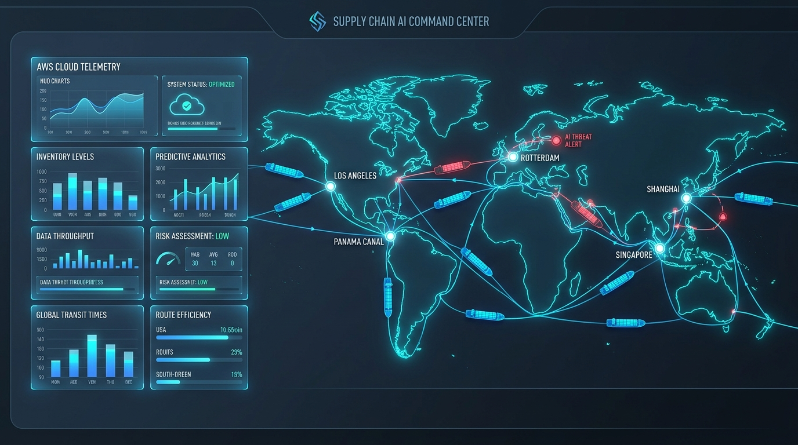

# SentinelChain AI



Supply-chain incident analysis and operational decision support using React, TypeScript, Express, Amazon Bedrock and Cognito. The existing dark Aurora palette, map background, navigation and card styling are retained.

## Verification and implementation status

The original project built, but notification delivery, diagnostics, report downloads, voice briefings, chat replies and operational actions contained simulations. Shipment, supplier and trend screens displayed fixed sample records. Backend endpoints did not verify Cognito identity and displayed roles were editable locally.

Implemented:
- Shared Express/Vercel API handlers, JWT verification and Cognito group checks for dispatch.
- Bedrock analysis with response validation and explicit errors; a downstream Lambda/storage failure no longer discards a successful analysis.
- DynamoDB incident history, read back for the authenticated user on login. Optional integration results accompany analysis.
- Real SNS publishing, labelled **accepted**, with no fabricated delivery receipts.
- Bedrock chat with selected incident/conversation context, browser speech synthesis and downloadable PDF reports.
- Data and operation adapter endpoints; dashboards read connected records and actions wait for provider completion.
- Consistent page spacing, responsive tables and visible keyboard focus, preserving the original colours and styling.

**Not verified against production:** Cognito account flows, Bedrock inference, DynamoDB, Lambda, EventBridge, SNS subscriptions and carrier/ERP data or execution. This checkout has no `.env` or live provider credentials. Their absence produces setup errors, never simulated success. Route comparison and impact curves are labelled scenarios/estimates, not a live routing optimizer or validated financial forecast. Token visualizations are illustrative, not model attention introspection. CloudWatch telemetry is not connected; unavailable measurements stay unavailable.

## Run locally

Requires Node.js 22 or newer (validated on Node 24).

```sh
npm ci
# Copy .env.example to .env and configure integrations.
npm run dev
```

Open http://localhost:3000. For production:

```sh
npm run build
npm start
```

`npm start` sets production mode and respects `PORT`. Vercel uses the same API implementation and the Vite build. Set VITE_COGNITO variables before building the frontend. The SPA requires real Cognito sign-in; no password bypass is supplied.

Cognito groups: `Admin`, `Supply Chain Manager`, `Logistics Executive` may dispatch operations and alerts. `Analyst` and users without these groups cannot dispatch. Signup's requested role does not grant permissions; administrators assign groups. Configure a public app client without a client secret and email/password sign-in. Additional MFA challenges are reported explicitly; interactive MFA completion is not implemented.

AWS permissions should cover the configured resources only: Bedrock Converse model invocation, DynamoDB PutItem/Scan, Lambda InvokeFunction, EventBridge PutEvents and SNS Publish. Configure EventBridge rules and SNS subscriptions in your AWS account. Slack and PagerDuty topics need their actual delivery adapters/subscriptions; topic acceptance alone does not establish delivery.

## Data adapter contract

`DATA_SOURCE_URL` is a trusted server-side URL returning a JSON object. Optional bearer authentication uses `DATA_SOURCE_TOKEN`. Requests refresh every 60 seconds. Missing arrays render no records; the original sample objects retained in components define the required field types and are not displayed as live records.

| Array | Required fields |
|---|---|
| shipments | id, vessel, carrier, route, cargo, eta, status, delay (strings) |
| delays | id, vessel, carrier, route, cargo, eta, cost, delay, risk (strings) |
| suppliers | Match the SupplierHealth row schema in EnterprisePages.tsx |
| backups | target, backup, region, reliability, premium, onboarding (strings), active (boolean) |
| suggestions | component, current, recommended, adjustment, cost, status (strings) |
| trendData | month (string), baseline, current (numbers) |
| criticalHotspots | id, name, status, details, traffic, risk (strings), coords: {x, y} (map percentages) |
| supplierInsights | name, category, material, exposure, alternativeSource, status (strings), safetyStock (number) |

Adapters should enforce tenant-specific source permissions. The configured source is shared by signed-in users in this deployment; this is not a multi-tenant isolation layer. For large incident histories, replace the scan with a userId/createdAt DynamoDB index and paginated API.

## Operations adapter contract

`OPERATIONS_WEBHOOK_URL` receives `{id, type, target, userId, parameters}` with an `Idempotency-Key` header. Types are `playbook`, `supplier`, `inventory`. Optional bearer secret: `OPERATIONS_WEBHOOK_TOKEN`.

The provider must enforce its own authorization, validate the target/parameters against authoritative records, persist idempotency keys and execute the real operation. Return `{"status":"completed","reference":"provider-reference"}` only on actual completion. Pending, malformed and failed replies are not shown as completed. After a timeout or ambiguous response, reconcile with the provider using the action ID; the browser retains that ID for identical retries during the session. Provider-side idempotency remains necessary across sessions.

## APIs

All endpoints except performance metrics require a Cognito ID token as `Authorization: Bearer ...`.

| Method | Endpoint | Purpose |
|---|---|---|
| POST | /api/analyze-disruption | Analyze `{text}` with Bedrock |
| POST | /api/chat | Answer `{message, context}` |
| POST | /api/notify-sns | Publish `{channel, message, severity}` |
| POST | /api/operations | Execute a provider-confirmed action |
| GET | /api/history | Authenticated user's persisted analyses |
| GET | /api/data | Fetch operational source records |
| GET | /api/performance-metrics | Actual process uptime/memory and configuration status |

## Checks

```sh
npm run lint
npm test
npm run build
# With development server running and Microsoft Edge installed:
npx playwright test
```

Service tests cover validation, unavailable integrations, downstream failure isolation, SNS acceptance, execution acknowledgement/idempotency and authentication gates. Browser tests cover all 21 pages at desktop/mobile sizes, PDF download and notification failures. The development-only `tests/ui.html` fixture supplies a test identity and mocked API responses; it is not part of the production build and does not bypass backend authentication.

## Remaining deployment work

Supply production configuration and the real ERP/AIS/carrier adapters, configure AWS resources and Cognito groups, then run authenticated integration acceptance tests. Browser fixtures and mocked SDK tests cannot prove external delivery or real-world execution. No outbound notification or real carrier mutation was sent during verification.

MIT license. Original project by the SentinelChain AI team; see LICENSE and the in-app Team page.
